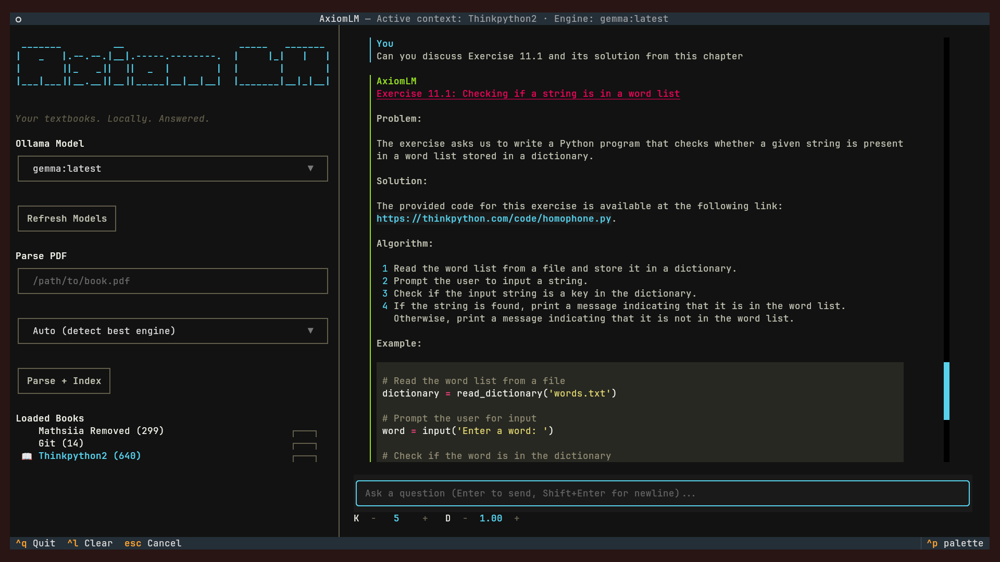
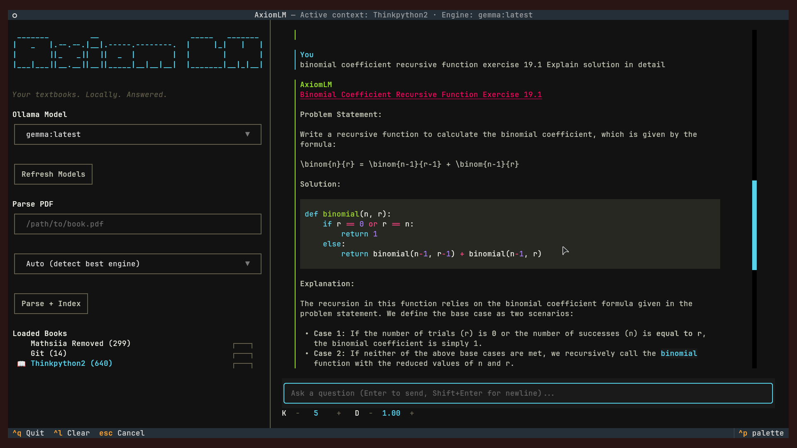
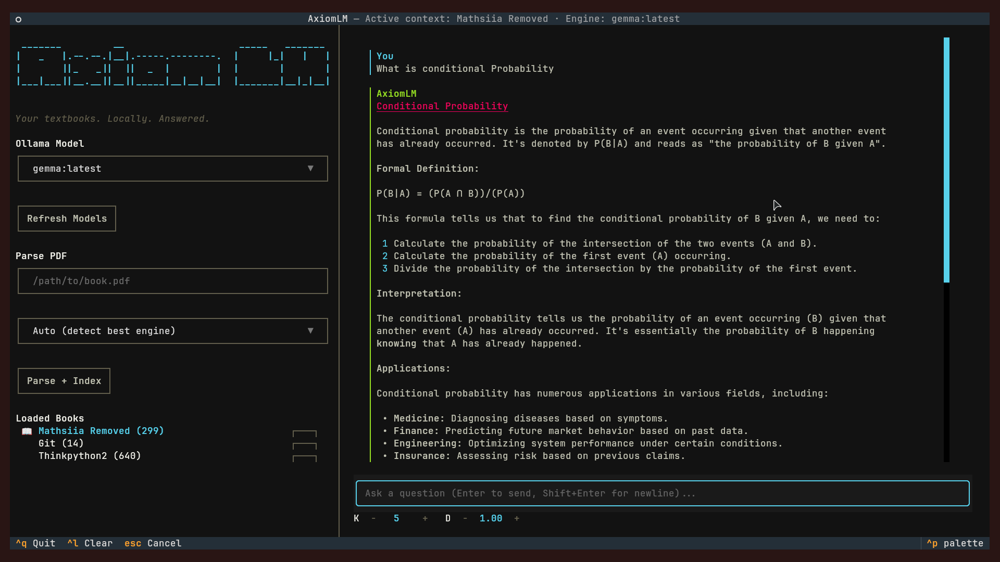

<div align="center">


### Your Textbooks. Locally. Answered.

A terminal study assistant for STEM and computer science textbooks, powered by local Ollama inference and book retrieval.


</div>

## Project status

Phase 0 is accepted on the development host. The Phase 1 command-driven Textual interface is implemented in this checkout; controlled Kitty/Alacritty terminal and clipboard checks passed, while human key/drag/readability acceptance is still pending. The roadmap distinguishes later planned capabilities. OCR/scanned-PDF processing is frozen; effort moves to model lifecycle, UI, retrieval, tools and evaluation.

Core inference stays local with no silent cloud API fallback. Once models/dependencies are downloaded, the current book chat path can run offline. Planned web search/fetch are explicit evidence tools and require internet. A separate manually triggered Ask cloud button is optional, last, and outside core routing.

## Available today

- Command-driven Textual 8.2.6 study stream with live local Ollama output, cancellation and a one-question queue.
- Per-book ChromaDB collections and Jina asymmetric retrieval embeddings.
- Header/boundary-aware overlapping chunks with physical-page metadata.
- Follow-up retrieval, page-aware queries and metadata-derived source lists. These lists are retrieved evidence, not verified claim citations.
- PDF engine selection, parse/index progress and resumable page checkpoints.
- Seven built-in themes, settings-hidden retrieval controls, native selection, and `/copy` / `/copy code` via explicit clipboard transports.

The configured target is **Qwen3.5-4B Q4_K_M**, using the exact Ollama tag `qwen3.5:4b-q4_K_M`. Phase 0 acceptance passed on the RTX 3050 6GB development machine: Ollama 0.40.4 tool-calling, GPU generation at the 4096-token context limit, unload, CUDA Jina ingestion/release, and CPU live-query placement have recorded evidence. The baseline comparison uses a retrospective reconstruction with truncated before answers, so answer-quality comparisons are directional. Maintainer-local status and evidence are recorded in PHASES.md and MEMORY.md; those files are not part of the public README distribution.

## Screenshots

Historical screenshots of the previous interface; they do not depict the Phase 1 stream.





## Setup and use

Linux, Python 3.11+, and [uv](https://docs.astral.sh/uv/getting-started/installation/) are required. Install [Ollama](https://ollama.com/) and start its local service. The primary overhaul target is a Linux/Niri/Wayland laptop with an RTX 3050 6GB GPU and 16GB RAM. Runtime defaults, paths and tuning parameters live in `src/config.py`.

Clone the project and run the installer. It syncs the pinned CUDA profile and development tools from `uv.lock`, then pulls the configured local Ollama model:

```bash
git clone https://github.com/JustJoyful/AxiomLM.git
cd AxiomLM
bash install.sh
source .venv/bin/activate
uv run --no-sync python -m src.tui
```

`install.sh` delegates to `scripts/setup_env.sh`. Use `--cpu` for the pinned CPU Torch profile, `--no-model` to skip both the pinned Jina snapshot download and Ollama model pull, and `--dry-run` to inspect all setup commands without changing the environment. Normal setup downloads the configured Jina revision and pulls the configured Ollama model. The sync preserves separately installed optional OCR engines. Use `uv run --no-sync axiomlm` to launch the installed entry point. `pyproject.toml` declares dependencies and `uv.lock` pins their resolved versions; the installer uses `uv`'s cache rather than staging multi-gigabyte CUDA wheels in `/tmp`.

The UI requires a UTF-8 interactive terminal, at least 40×12 cells (80×24 recommended). Install `wl-clipboard` for Wayland copying. Textual is pinned to 8.2.6. Bubblewrap/cgroups v2/SymPy execution and Typst export remain later-phase work. Physical compatibility across terminal applications has not yet been accepted.

### Parse and query a book

Use commands in the prompt, then type a question:

```text
/parse "/absolute/path/数学 notes.pdf" --mode auto
/books
/book book
/models
/model qwen3.5:4b-q4_K_M
```

`/parse` accepts `--mode auto|pymupdf4llm|mineru|marker` and explicit degraded `--cpu-embeddings`. Heavy engines require their installed runtime and sufficient hardware. MinerU is installed separately. Parsing a previously indexed book replaces its collection; parsed checkpoints remain resumable.

Enter sends; Shift+Enter, Alt+Enter or Ctrl+J inserts a newline. Up/Down recalls history at the first/last line. Ctrl+P opens commands; Tab completes without executing. Escape closes an overlay first, otherwise cancels active work or clears the draft. PgUp/PgDn scroll; End resumes following output. Ctrl+L or `/clear` clears the display when idle; `/new` also clears conversation. `/quit` or two idle Ctrl+C presses exits.

While generating, one additional question can queue with its captured book/model; book/model changes and destructive clearing are blocked until work resolves. Cancel/error returns the queued question to the prompt. Client abort is distinct from server unload: new GPU work stays blocked until cleanup is confirmed.

`/sources` expands retrieved page metadata; `/details` shows observed steps. `/copy` copies the last completed answer with raw LaTeX; `/copy code` copies the last fenced block without gutters or added indentation, preserving trailing blank lines. Optional positive `n` chooses the nth-last answer/block. Unsupported model footnotes and claim markers are removed; canonical refusals suppress continuation. Changed answer copies begin `[AxiomLM sanitized answer]`. Code remains exact. Wayland uses `wl-copy`; if it fails, an applicable native `xclip`/`xsel`/`pbcopy` transport is preferred over unacknowledged OSC 52. When only a terminal transport is available, the message says “OSC 52 copy requested” because terminal support cannot be confirmed. Controlled Wayland code/raw-LaTeX and Kitty OSC52 byte comparisons passed on the development host.

### Themes and preferences

`/theme` previews live; Enter keeps, Escape reverts. Built-ins: `terminal` (default), `mono`, `catppuccin-mocha`, `gruvbox-dark`, `nord`, `tokyo-night`, `paper`. `/accent cyan` selects an ANSI accent for terminal mode. Preferences live in `~/.config/axiomlm/config.toml`; custom theme TOML files live in `~/.config/axiomlm/themes/`. Saves preserve unrelated settings/comments atomically.

`AXIOM_THEME` overrides the saved selection at startup; presence of `NO_COLOR` forces monochrome. `AXIOM_REDUCE_MOTION=1` or presence of `NO_MOTION` disables decorative motion. Terminal mode retains ANSI palette indexes; contrast depends on the terminal palette. Final Unicode math formatting waits until an active answer selection clears.

`/help` lists commands. `/thinking`, `/web` and `/export` report their later-phase availability; these backends are not implemented. Practice and coverage-gap features remain planned.

The CLI extraction/indexing path is:

```bash
uv run --no-sync python -m src.ocr --mode auto --pdf /absolute/path/to/book.pdf
uv run --no-sync python -m src.indexer book
```

Replace `book` with the PDF stem. Existing collection replacement is explicit:

```bash
uv run --no-sync python -m src.indexer book --reindex
```

Reindexing replaces that book's vector collection; retain the parsed page artifacts.

### Existing OCR behavior (frozen)

`src/ocr.py` is the unified entry point. PyMuPDF4LLM handles clean digital PDFs on CPU; MinerU handles scan-heavy PDFs with GPU batching/checkpoints; Marker remains a manual alternative for sufficiently capable hardware.

Auto-routing samples up to eight evenly spaced pages. It considers low extractable text and high image coverage, including image-heavy pages with an OCR text layer. MinerU is selected when at least half the samples are scan-like; thresholds and overrides remain in the existing code/configuration. Parse speed depends on the book, engine and hardware; old timing estimates are not guarantees.

Checkpoints are stored in `data/parsed_md/checkpoints/<book_stem>/page_NNNN.md`, merged Markdown in `data/parsed_md/<book_stem>/full.md`, and vectors in `data/vector_store`. Checkpoint indices begin at zero; cited physical PDF pages begin at one and may differ from printed book labels.

### Retrieval controls

Use `/settings`, `/k 5` (3–20) and `/d 1.5` (finite, nonnegative) for actual retrieval count and distance filtering. Defaults come from `src/config.py`. The labeled SICP comparison preserved accepted K=8 IDs; configured K=5 increased precision from 0.542 to 0.600 and reduced recall from 0.778 to 0.694 over three labeled answerable cases. Fresh stochastic answers still included unsupported claims and page-1 under-answering. These settings do not provide a quality guarantee. Hybrid retrieval and entailment verification remain Phases 2 and 4.

## Overhaul roadmap

Build in order. Detailed acceptance criteria are in the maintainer's local `PRD.md`; the public scope summary is below.

| Phase | Planned outcome |
| --- | --- |
| **0 — Foundation** | Exact Qwen3.5-4B Q4_K_M tag/digest; verified Ollama tool round-trip; GPU ingest, explicit release, CPU queries; local inference boundary |
| **1 — Textual UI** | Implemented in checkout; human key/drag/readability acceptance pending |
| **2 — Context** | Chapter/section metadata, 8192-token non-overlapping contextual blocks and late chunking, follow-up rewriting, BM25 + dense search, direct 5–8 chunk synthesis |
| **3 — Tools** | Local search, web search/fetch, sandboxed Python, PDF/citation tool interfaces; warm SymPy worker, verified solve flow and honest failure |
| **4 — Trust** | One sub-100M CPU entailment model for gate/rank and citation checks; labeled per-book evaluation |
| **5 — Study/documents** | Practice questions, coverage gaps, raw Typst → PDF with two retries maximum; optional flashcards |

Sandboxed Python uses Bubblewrap, network isolation and a cgroups v2 250M ceiling. The backend enforces a roughly 5s response deadline while preserving the warm worker; timeout cancellation and dead-worker recovery must be demonstrated before shipping.

Time-boxed floor: **Phases 0–2 plus the Phase 4 eval harness**. Begin labels/baseline before pipeline changes. Phase 3 is the most ambitious/time-consuming addition. Phase 1 may be explicitly deferred; Phase 1 and Phase 5 are the first permitted cuts, and flashcards are lowest priority. The floor does not require full Phase 3 or the Phase 4 trust scorer. No OCR overhaul, cloud routing, Pyodide or iterative map-reduce.

## Repository map

```text
src/
  config.py          Runtime paths, models and tunable parameters
  tui.py             Textual app and query/ingest orchestration
  ui/                Stream, commands, themes, rendering and one axiom.tcss
  db.py              ChromaDB and Jina embedding integration
  indexer.py         Current chunking, metadata and indexing
  clipboard.py       Explicit stdin/OSC 52 clipboard transports
  ocr.py             Frozen extraction entry point
  ocr_*.py           Frozen extraction engines
  checkpoint.py      Frozen per-page artifacts
  preprocessor.py    Frozen preprocessing
scripts/             Existing setup and page-validation utilities
data/                Local parsed artifacts, vector indexes and logs
PRD.md               Product scope, build order and acceptance gates
ARCHITECTURE.md      Current baseline and target implementation contracts
RULES.md             Mandatory development constraints
AGENTS.md            Coding-agent entry point and commands
```

## Contributing and verification

When working in the maintainer's local workspace, read `AGENTS.md` and `RULES.md` before making changes. Those local documents, `PRD.md` and `ARCHITECTURE.md` are intentionally excluded from GitHub. The public phase summary above records the scope; contributors should confirm the applicable phase before implementation. Keep scope/status documentation aligned with actual code and preserve the frozen extraction pipeline. Runtime configuration belongs in `src/config.py`.

```bash
uv run --no-sync pytest -q
uv run --no-sync ruff check src/ui src/tui.py src/clipboard.py src/llm.py scripts/validate_tui_phase1.py tests/tui
uv run --no-sync python scripts/validate_tui_phase1.py
uv run --no-sync python scripts/validate_tui_workload.py
uv run --no-sync --extra dev black --check src/
uv run --no-sync python scripts/validate_page_metadata.py book
uv run --no-sync python scripts/validate_page_querying.py book "sample question"
```

The metadata validator requires an indexed book; the page-query validator checks parsing/citation and mounted TUI wiring offline. These checks cover the existing pipeline; they are not the planned labeled eval harness. Future pipeline changes require before/after retrieval precision/recall, citation accuracy and hallucination measurements. Use `type(scope): description` commit messages.

## License

MIT, as declared in `pyproject.toml`.
