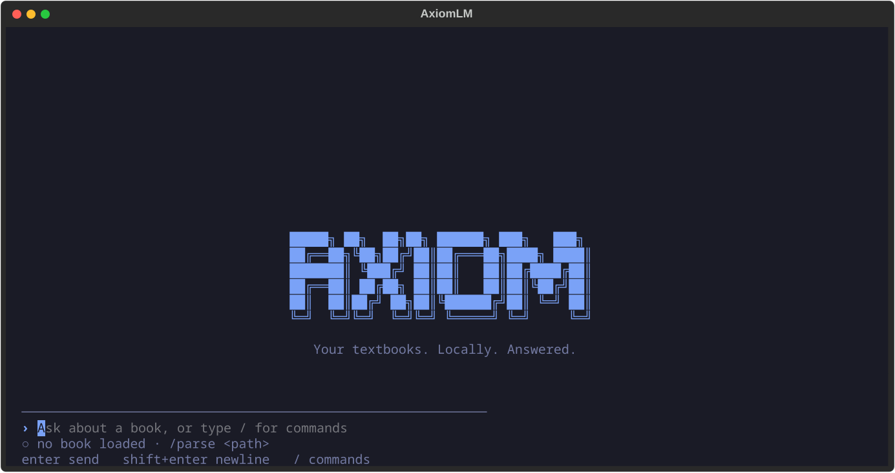
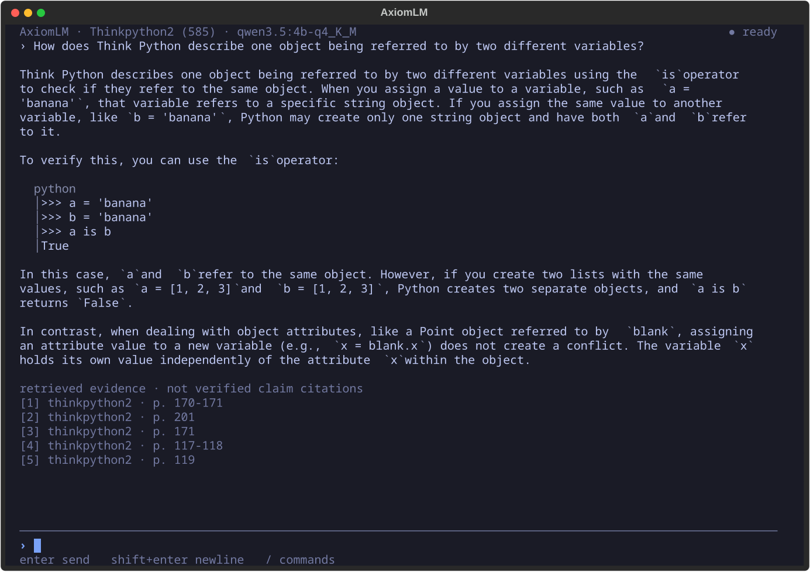

<div align="center">


### Your Textbooks. Locally. Answered.

A terminal study assistant for STEM and computer science textbooks: local OCR, hybrid book retrieval, a bounded tool-using agent with sandboxed math, and local Ollama inference.


</div>



## Highlights

- **Local first.** Inference runs on a local Ollama model (`qwen3.5:4b-q4_K_M`). There is no silent cloud fallback; once models are downloaded, book chat works offline. Web evidence is opt-in per question.
- **Textbook ingestion.** PDF → Markdown with automatic engine routing (PyMuPDF4LLM for digital PDFs, MinerU for scans, Marker manually), resumable per-page checkpoints and physical-page provenance.
- **Hybrid retrieval.** Versioned per-book indexes pair Jina dense embeddings (late chunking over ≤8192-token contextual blocks) with SQLite FTS5/BM25. Follow-up questions are rewritten from recent turns; page-targeted questions ("what does page 42 say") are handled directly.
- **Bounded agent.** Every question searches the book first. Solve questions compute with SymPy inside a Bubblewrap/cgroups sandbox and are checked by a separate trusted symbolic verifier; unsupported checks are reported as *unverified* rather than solved.
- **Study tools.** Source-linked practice questions per section, study coverage tracking, and Typst → PDF export of answers.
- **Evaluation harness.** Labeled per-book retrieval/answer evaluation, an offline CPU entailment scorer, and before/after quality comparison tooling.
- **Polished TUI.** Textual app with a command palette, one-question queue, cancellation, seven built-in themes plus custom themes, and reliable copy of answers and code blocks.



## Requirements

- Linux, Python 3.11+, [uv](https://docs.astral.sh/uv/getting-started/installation/)
- [Ollama](https://ollama.com/) running locally (validated with Ollama 0.40.4)
- A UTF-8 terminal, at least 40×12 cells (80×24 recommended)
- Optional: `wl-clipboard` (Wayland copy), MinerU (scanned PDFs), Typst (PDF export), Bubblewrap + a user systemd manager with cgroups v2 (sandboxed Python and restricted Typst compilation), a self-hosted SearXNG instance (web evidence)

The primary target is a laptop with an RTX 3050 6GB GPU and 16GB RAM. GPU OCR, embedding ingestion and LLM generation never overlap; live queries embed on CPU. A CPU-only install profile exists but CPU-only operation has not yet been fully validated.

## Install and run

```bash
git clone https://github.com/JustJoyful/AxiomLM.git
cd AxiomLM
bash install.sh
uv run --no-sync axiomlm          # or: uv run --no-sync python -m src.tui
```

`install.sh` syncs the pinned CUDA profile from `uv.lock`, downloads the pinned Jina embedding revision and pulls the configured Ollama model. Options:

| Flag | Effect |
| --- | --- |
| `--cpu` | Use the pinned CPU Torch profile |
| `--no-model` | Skip the Jina download and Ollama pull |
| `--dry-run` | Print the setup commands without running them |

Always run with `uv run --no-sync` (or activate `.venv`) so the chosen Torch profile and separately installed OCR engines stay intact. All runtime paths, model IDs, budgets and tuning parameters live in `src/config.py`.

## Usage

Add a book, select it and ask a question:

```text
/parse "/absolute/path/to/book.pdf" --mode auto
/books
/book book
What is the substitution model of procedure application?
```

Parsing a book that is already indexed builds a replacement index version beside the old one and activates it only after validation; parsed checkpoints and previous versions are kept.

### Commands

| Command | Description |
| --- | --- |
| `/parse <path> [--mode auto\|pymupdf4llm\|mineru\|marker] [--cpu-embeddings]` | Parse and index a PDF |
| `/books [filter]`, `/book <name>` | List / switch indexed books |
| `/remove <book>` (`/delete`) | Remove a book after confirmation |
| `/models`, `/model <name>` | List / switch Ollama models |
| `/sources [n]`, `/details [n]` | Expand retrieved evidence / pipeline steps |
| `/copy [n]`, `/copy code [n]` | Copy an answer (raw LaTeX) or its last fenced code block |
| `/practice [section] [count]` | List sections, or generate 1–5 source-linked practice questions |
| `/coverage` | Show which sections you have studied (session and all-time) |
| `/export [n]` | Typeset an answer to PDF with Typst |
| `/web on\|off\|show` | Per-question permission to fetch web evidence (off by default) |
| `/thinking show` | Show the automatic thinking policy |
| `/k <n>`, `/d <value>`, `/settings` | Retrieval count (3–15), distance cutoff, settings |
| `/theme [name]`, `/accent <color>` | Preview/set theme, ANSI accent for the terminal theme |
| `/retry`, `/cancel`, `/clear`, `/new`, `/quit` | Retry, cancel work, clear display, new conversation, exit |
| `/gpu-parsing`, `/gpu-status` | Toggle / show the ingest embedding device |

### Keys

| Key | Action |
| --- | --- |
| Enter | Send |
| Shift+Enter, Alt+Enter, Ctrl+J | Newline |
| Up / Down | History (at first/last line) |
| Ctrl+P | Command palette; Tab completes without running |
| Escape | Close overlay, else cancel active work, else clear draft |
| PgUp / PgDn, End | Scroll, resume following output |
| Ctrl+L | Clear display when idle |
| Ctrl+C | Copy selection; twice when idle to exit |

While an answer is generating, one more question can be queued. Book/model changes and destructive clears are blocked until work finishes; cancelling returns the queued question to the prompt.

### Themes and preferences

Built-in themes: `terminal` (default), `mono`, `catppuccin-mocha`, `gruvbox-dark`, `nord`, `tokyo-night`, `paper`. `/theme` previews live (Enter keeps, Escape reverts). Preferences are saved in `~/.config/axiomlm/config.toml`; custom themes go in `~/.config/axiomlm/themes/`.

Environment overrides: `AXIOM_THEME=<name>`, `NO_COLOR` (monochrome), `AXIOM_REDUCE_MOTION=1` or `NO_MOTION` (no decorative motion).

### Clipboard

Wayland uses `wl-copy`; otherwise `xclip`/`xsel`/`pbcopy` are tried before OSC 52. When only OSC 52 is available, AxiomLM reports "OSC 52 copy requested" because terminal support cannot be confirmed. Copied code is exact; answers that were cleaned up (unsupported footnotes or claim markers removed) start with `[AxiomLM sanitized answer]`.

### Web evidence

Web search is retrieval only, never cloud inference. It requires a self-hosted SearXNG JSON endpoint set as `WEB_SEARCH_URL` in `src/config.py` and `/web on` for the question. The agent consults the web only after a failed or unverified solve, or when book evidence is insufficient. Fetches are SSRF-checked and pinned to public addresses.

## How it works

```text
PDF ─▶ src/ocr.py ─▶ per-page checkpoints ─▶ full.md ─▶ src/indexer.py ─▶ versioned dense + BM25 index
                                                                                    │
question ─▶ query rewriting / page intent ─▶ hybrid retrieval ─▶ agent (search → solve/verify → web?) ─▶ Ollama ─▶ TUI
```

- **Extraction.** Auto-routing samples up to eight pages and picks MinerU when at least half look scanned. Checkpoints live in `data/parsed_md/checkpoints/<book>/page_NNNN.md` (zero-based); merged text in `data/parsed_md/<book>/full.md`. Cited pages are one-based physical PDF pages and may differ from printed page labels.
- **Indexing.** Deterministic, non-overlapping contextual blocks embedded with Jina's `Document:`/`Query:` prefixes and late chunking. Each version is a dense (Chroma) + FTS5/BM25 pair activated through a single manifest. Older indexes stay readable until rebuilt.
- **Retrieval.** Dense and BM25 results are fused deterministically (interleave by default; reciprocal rank fusion is available as an opt-in experiment) and whole passages are selected within a context budget calibrated for the configured model.
- **Agent.** A deterministic state machine: classify → mandatory book search → local evidence assessment → solve (sandboxed SymPy + trusted check) → optional web → final answer. It is capped at 6 model requests, 6 tool calls and a 120 s deadline. Every request is token-counted with a native-chat counter that matches Ollama's Qwen3.5 renderer, so prompts always fit beside their output reserve. Other models use the simpler retrieval-and-answer path.
- **Sandbox.** Fail-closed native Python under Bubblewrap with network isolation and cgroups v2: 250M shared memory, no swap, 32 processes, bounded scratch. Generated code never runs outside it; missing prerequisites disable execution.
- **Trust signals.** Source lists show retrieved evidence, not verified citations. A pinned CPU NLI cross-encoder (`cross-encoder/nli-deberta-v3-xsmall`) is available for offline evaluation. Live citation checks (`CITATION_CHECK_ENABLED`) and the retrieval gate are off by default because they did not pass calibration.

### Command-line ingestion

```bash
uv run --no-sync python -m src.ocr --pdf /absolute/path/to/book.pdf --mode auto
uv run --no-sync python -m src.indexer book            # book = PDF stem
uv run --no-sync python -m src.indexer book --reindex  # build and activate a replacement version
```

## Project status

AxiomLM is developed in phases. Status as of November 2026:

| Phase | Scope | Status |
| --- | --- | --- |
| 0 — Foundation | Pinned model tag/digest, Ollama tool calling, GPU/CPU workload scheduling | Accepted |
| 1 — Textual UI | Command-driven TUI, queueing, cancellation, themes, clipboard | Accepted (Kitty, Alacritty on Wayland) |
| 2 — Context | Contextual blocks, late chunking, BM25 + dense hybrid search, follow-up rewriting | Provisionally accepted |
| 3 — Tools | Book search, web search/fetch, sandboxed Python, trusted math checks | Accepted with known limitations |
| 4 — Trust | Evaluation harness, CPU entailment scorer, advisory citation checks | [Provisionally accepted](docs/phase4-provisional-acceptance.md); live checks off |
| 5 — Study | Practice questions, coverage, Typst export | Accepted; human content review pending |
| 6 — Quality | [Quality tooling](docs/phase6-quality.md), RRF experiment, CPU portability | In progress |

Known limitations:

- Answers can still contain factual errors. A selectively audited 10-answer review found 7/63 factual errors (11.1%) and rejected 1 of 2 false premises; this is not a general quality guarantee.
- Retrieval quality is still being measured; label expansion and pooled test-recall evaluation are pending. RRF improved one book and regressed another, so it is not the default.
- CPU-only operation and terminals beyond Kitty/Alacritty are not yet validated.
- Context budgeting and token counting are calibrated only for `qwen3.5:4b-q4_K_M` on Ollama 0.40.4; other models need recalibration.

## Repository map

```text
src/
  config.py            Runtime paths, model IDs, budgets and tuning
  tui.py, ui/          Textual app, commands, stream, prompt, themes, axiom.tcss
  workloads.py         GPU/CPU admission control
  llm.py               Ollama client (local only, keep_alive 0)
  ocr.py, ocr_*.py     PDF extraction and engines (frozen)
  checkpoint.py, preprocessor.py   Per-page artifacts and preprocessing (frozen)
  text_repair.py       Downstream parsed-text repair
  indexer.py, late_chunking.py, index_metadata.py, index_store.py, db.py
                       Contextual chunking, provenance and versioned dense/BM25 stores
  query_rewriting.py, page_querying.py, hybrid_retrieval.py, retrieval.py
                       Query path and rank fusion
  agent.py, chat_tokens.py, answer_tokens.py
                       Agent state machine, token accounting, answer post-processing
  tools/               Tool schemas, registry, book/web tools, trusted math checks
  sandbox/             Bubblewrap/cgroups Python sandbox
  entailment.py, citation_check.py   CPU NLI scorer and advisory citation checks
  study.py, study_state.py, documents.py, typst_compile.py
                       Practice, coverage and Typst export
  clipboard.py         Clipboard transports
scripts/               Setup, validation, probes and evaluation tools
tests/                 Unit, TUI (pilot + snapshots) and sandbox host tests
docs/                  Screenshots and phase reports
```

## Development

```bash
uv run --no-sync pytest -q                                     # full suite
AXIOM_RUN_SANDBOX_HOST_TESTS=1 uv run --no-sync pytest -q tests/sandbox   # host sandbox cases
uv run --no-sync --extra dev ruff check src/ scripts/
uv run --no-sync --extra dev black --check src/
```

Sandbox host tests are skipped by default; skips do not establish sandbox acceptance. `scripts/validate_*.py` and `scripts/evaluate_*.py` are acceptance and evaluation tools (TUI, page metadata/querying, Phase 2–6 checks, sandbox). Most write JSON reports and refuse to overwrite an existing path, so give each run a fresh `--output`, for example:

```bash
uv run --no-sync python scripts/validate_python_sandbox.py --output data/logs/phase3_sandbox/<new-run>/report.json
uv run --no-sync python scripts/validate_phase2_context.py sicp
```

Contribution guidelines:

- Keep runtime configuration in `src/config.py`; keep the local-only inference boundary.
- The OCR engines, `checkpoint.py` and `preprocessor.py` are frozen; change callers or downstream indexing instead.
- Index schema or embedding changes need a reindex plan that preserves parsed artifacts.
- Retrieval or answer pipeline changes should come with before/after evaluation evidence.
- Commit messages use `type(scope): description`.

## License

MIT, as declared in `pyproject.toml`.
